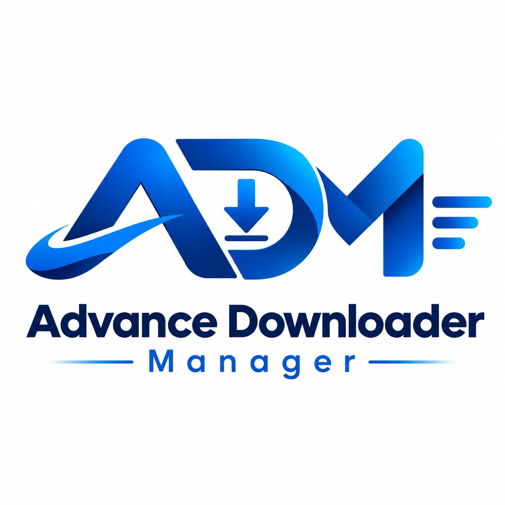
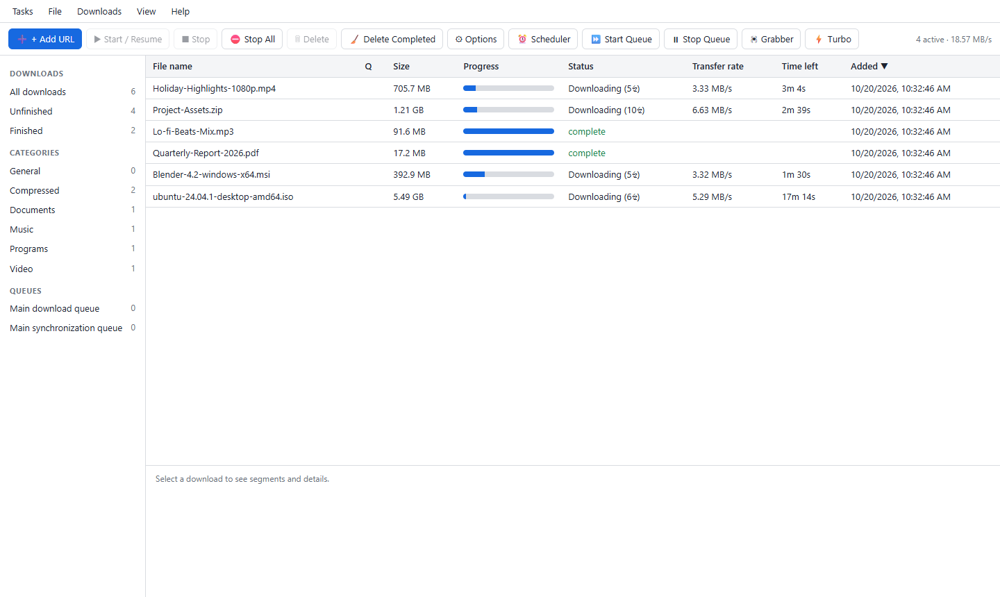
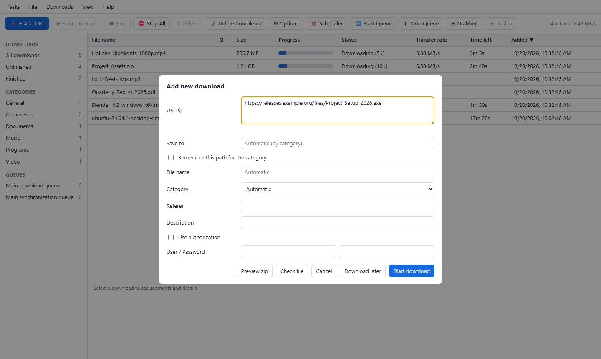
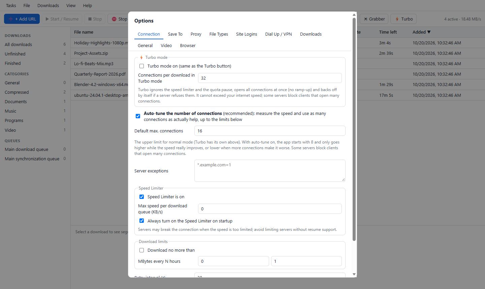

<div align="center">



# Advance Download Manager

### Download all types of files — faster. Free, open source, native on Windows.

Archives · installers · ISOs · documents · music · video · anything with a link — segmented, resumable and self-tuning, with your browser taken over automatically

<br>

[](https://github.com/kaushalsah606/ADM---Advance-Download-Manager-/releases/latest)
[](https://github.com/kaushalsah606/ADM---Advance-Download-Manager-/actions)
[](LICENSE)


[**⬇ Download for Windows**](https://github.com/kaushalsah606/ADM---Advance-Download-Manager-/releases/latest) ·
[Features](#-features) ·
[Screenshots](#-screenshots) ·
[Videos](#-videos-too) ·
[Browser integration](#-browser-integration) ·
[Docs](#-documentation)

<br>



</div>

---

## ✨ Why Advance Download Manager?

| | |
|---|---|
| 📁 **Every kind of file** | Zip, rar and ISO images, installers, PDFs and documents, music, video, images, disk images, big game files: over **HTTP, HTTPS, FTP, HLS, DASH and RTMP**, with logins, cookies and proxies. Files are sorted into categories and saved in your `Downloads` folder. |
| ⚡ **Fast, and tuned for your line** | Splits every file into live segments and **measures the real speed**: more connections only while they help, fewer when a server gets slower. **Turbo** removes every limit with one click. |
| ▶️ **Videos too** | A **Download this video** button over playing videos (YouTube, Facebook, Instagram, TikTok and 1,000+ sites): pick a quality and press *Download*. The video tools are **included**: nothing else to install. |
| 🌐 **Takes over your browser** | Chrome, Edge and Firefox extensions pair themselves with the app (one *Allow*). Downloads, media on the page, *download all links*, right-click menu. |
| 🪟 **A real Windows app** | Own window, tray icon, notifications (click one to open the folder), installer and portable zip. English interface, dark mode. |
| 🔁 **Never starts over** | Resume after failures, restarts and power cuts. Queues, scheduler, speed limiter, quota, completion actions. |
| 🔒 **Private by design** | Everything stays on `127.0.0.1`. No account, no ads, no telemetry. MIT licensed. |

---

## 🚀 Get started

| | |
|---|---|
| 🪟 **Windows installer** | [`AdvanceDownloadManager-<version>-win-x64-Setup.exe`](https://github.com/kaushalsah606/ADM---Advance-Download-Manager-/releases/latest). Per-user (no admin needed), Start-menu entry, optional desktop icon and start with Windows. |
| 📦 **Portable** | [`…-win-x64-portable.zip`](https://github.com/kaushalsah606/ADM---Advance-Download-Manager-/releases/latest): unzip anywhere, run `AdvanceDownloadManager.exe`. |
| 🧑‍💻 **From source** (any OS) | `git clone https://github.com/kaushalsah606/ADM---Advance-Download-Manager-.git` → `npm start` (Node.js ≥ 20, nothing to install). Open the printed address in your browser. |

**Needs:** the Microsoft Edge WebView2 Runtime (already on Windows 11 and current Windows 10; the app offers to download it if missing).

> **About the signature.** The executables and installer are Authenticode-signed with a timestamp. Unless the release notes say a CA certificate was used, the signature is **self-signed**: it proves the files were not changed after signing, but Windows SmartScreen shows "unknown publisher" until a CA-issued certificate is used. Check every download against `SHA256SUMS.txt`. How to get a trusted signature: [docs/SIGNING.md](docs/SIGNING.md).

---

## 🖼 Screenshots

<table>
<tr>
<td width="50%"><br><sub><b>Add URL</b> opens with the link you copied last already pasted.</sub></td>
<td width="50%"><br><sub><b>Options → Connection</b>: auto-tune, Turbo, limits.</sub></td>
</tr>
</table>

---

## 🎯 Features

### ⚡ Speed

* **Dynamic segmentation:** the largest remaining part is always split in half for a free connection; a 64-byte overlap check detects broken servers and falls back to one connection.
* **Self-tuning connection count** (*Options → Connection → Auto-tune*, on by default): starts with 8, measures, tries more, keeps them only if the speed really improves (≥ 15 %), tries fewer when more makes it worse, and re-tests during long downloads. Up to 32 (Turbo: 64).
* **⚡ Turbo mode** (toolbar button, *Downloads* menu or tray): no speed limiter, no quota pause, more connections at once; it backs off by itself if a server refuses them.
* **Honest numbers:** on a mock server that is best at 6 to 8 connections, auto-tune finished in **6.1 s vs 18.2 s** for a fixed 32 connections; on a per-connection-limited server **3.1 s vs 21.7 s** for a fixed 4. On a real public test server the old fixed 8 connections gave **1.0 MB/s**, auto-tune **3.7 MB/s**. No downloader can beat your line or the server's own limit.
* **Readable speeds:** B/s, KB/s below 1 MB, MB/s below 1 GB, then GB/s.

### 📥 Downloading

* **Protocols:** HTTP/HTTPS (Basic, Digest, NTLMv2, cookies, redirects, `multipart/byteranges`), FTP (passive, resume), HLS/m3u8 (AES-128), DASH/MPD (merged with FFmpeg), RTMP (to FLV).
* **Proxy:** none, system, sandboxed **PAC script**, manual per protocol, SOCKS 4/5, bypass list.
* **Management:** categories, download and sync queues, scheduler, completion actions (exit, shut down, hang up, run a program), batch download (`img*.jpg`), **Site Grabber**, zip preview, duplicate-link policy, virus-check hook, Dial-Up/VPN with redial.
* **Import / export:** `.ief` / `.ef2` text lists, JSON, plain text.
* **Files land in your `Downloads` folder** by default (change per category in *Options → Save To*).

### 🪟 Windows app

* Native window, tray icon (*Open*, *Start main queue*, *Stop all*, *Turbo*, *Exit*), live speed in the tooltip, and a **"Download complete" notification — click it to open the folder** with the file selected.
* **Add URL pastes the link you copied last.** Copying a link shows *"Download this link? (click here)"*.
* In-app dialogs only: no browser-style boxes, permission pop-ups or page right-click menu.
* One instance (starting it again brings the window forward), **starts with Windows by default** (in the tray; switch off in *Options → General*), `--minimized`, `--quit`, `/d URL /p dir /f name /q` command line.
* **Updates:** *Help → Check for updates* downloads the release, verifies it against `SHA256SUMS.txt` and installs it only after you click *Install now*.

### 🔔 Download File Info and duplicates

Every **captured** download (browser, copied link, other programs) opens **Download File Info** first: URL, **Category**, **Save As**, *Remember this path*, description, file icon, size and type from the server, and **Preview** (lists the files inside a ZIP without downloading it). Choose **Start Download**, **Download Later** or **Cancel**.

If a link is **already in your list**, the app shows the existing entry and lets you add a numbered copy (`file_2.zip`), overwrite, or keep / resume the existing one, and can remember your choice.

---

## ▶️ Videos too

Play a video in your browser and click **Download this video** (or use the toolbar popup, the right-click menu, or *Tasks → Download video from a page address…*). A window shows the thumbnail, title, site and length and a list of **qualities with sizes** (best first, down to 144p, *Audio only* and *MP3*). Pick one, choose the folder and press **Download**: it behaves like any other download (progress, speed, pause and resume, queue, notifications).

<details>
<summary><b>Details and limits</b></summary>

* **Nothing to install:** the video engine is included in the installer and the portable zip and checked when the release is built. *Options → Video* shows it and can update it.
* **YouTube** is read directly, without signing in; videos from other sites are read by the built-in video engine, which automatically tries other ways if a site rejects the first request.
* **Logins:** the browser's cookies for the site are passed to the app so videos that need a login work; they are used only for that download and deleted afterwards. In feeds (Facebook, Instagram, TikTok, X) the post's own address is used.
* **Right-click menu:** on a link to a video page, on selected text that is a web address, on a page, video, audio or image.
* **Limits:** DRM-protected videos (Netflix, Disney+ …) and live streams are not supported. Sites change and sometimes refuse connections they consider automated (TikTok and YouTube may); the dialog shows the reason, and updating the video engine in *Options → Video* usually helps. **Only download videos you have the right to download — the terms of some sites forbid it.**

</details>

---

## 🌐 Browser integration

1. **Install the extension once.** The installer's last page offers *Set up the browser extension*, and *Options → Browser* has buttons that open the extension folder and each browser's extensions page. Chrome/Edge: *Developer mode* → *Load unpacked* → `browser-extension\chrome`. Firefox: *Load Temporary Add-on* → `browser-extension\firefox\manifest.json`. (Store packages and listing text are ready in [docs/STORE-LISTING.md](docs/STORE-LISTING.md).)
2. **That's all.** The extension finds the app, and the app asks **"Allow this browser extension to connect?"**. Press *Allow* once. No port or token to copy; the connection survives restarts.
3. From then on browser downloads are taken over while the app is running.

**In the toolbar popup:** connection status, **Take over downloads** and **Download button on videos** switches, **Show on this site** (hide the video button for one website only), media found on the page, *Download video from this page* and *Download all links on this page*. The same settings are in the extension's Options page, in a light or dark design that follows your browser.

<details>
<summary><b>Catching downloads of other programs (Windows)</b></summary>

*Options → Browser → Catch plain-HTTP downloads from every program* routes the plain-`http://` traffic of **all** programs through the app's capture proxy, so a download started by any Windows program that follows the system proxy settings is taken over. The proxy script ends every answer in `DIRECT`, so the internet keeps working if the app is closed or crashes; your previous setting is restored when you switch it off or quit, and repaired at the next start after a crash. HTTPS is never decrypted, so HTTPS downloads of non-browser programs cannot be captured (browsers are covered by the extension). Off by default.

</details>

---

## 🧰 Development

```bash
npm start                                   # source run: engine + UI
node bin/advance-download-manager.js /d https://host/file.zip /p D:\dl /f name.zip /q
npm test                                    # 154 integration tests (local mock servers, no internet)
npm i --no-save jsdom && npm run test:ui    # 72 UI checks against the real page
npm run build:extensions                    # dist/chrome and dist/firefox
npm run release                             # Windows: native app, installer and portable zip in release/
npm run test:e2e                            # Windows: real Edge, Firefox, native window, PC-wide capture, OS commands
```

State is kept in `~/.advance-download-manager/`. Details: [docs/BUILD.md](docs/BUILD.md), [docs/ARCHITECTURE.md](docs/ARCHITECTURE.md).

---

## 🔐 Security model

The engine listens on `127.0.0.1` only, rejects foreign `Host` headers and requires a token on every call; only browser-extension origins get CORS access. The window shows only `http://127.0.0.1` pages, other links open in your default browser, WebView2 developer tools are off, and the page can ask the window for one thing only: a web address from the clipboard. Credentials are sent only after a server challenges. Exports never contain passwords or cookies. PAC scripts run in a `vm` sandbox with a time limit (load only PAC files you trust). HTTPS is never decrypted. Update downloads are limited to this repository's releases and checked by SHA-256. Report vulnerabilities as described in [SECURITY.md](SECURITY.md).

---

## ✅ Verification

| Area | How it was verified |
|---|---|
| Engine, protocols, UI logic | **154 automated tests** (mock servers, no internet) and **72 UI checks** against the real page |
| Speed | `test/tuner.test.js` (simulated servers: best at 8 connections and worse beyond, too-high start, a faster line mid-download, noise, stalls), `test/autotune.test.js` and `test/turbo.test.js` against throttled mock servers |
| YouTube videos | `test/youtube.test.js` (address parsing, ranged download with resume); manually against a real video (1080p H.264 + AAC) |
| Video downloads (other sites) | `test/video.test.js` with a stand-in video engine: quality choices, command-line safety, request → quality → download → merge, pause / resume, error explanations |
| Chrome / Edge extension | Real Edge, 19 checks (pairing, takeover, media sniffing, the video button, cookie hand-over, popup) |
| Firefox extension | Real Firefox, 17 checks |
| Native window and tray | Real host + WebView2, 28 checks (window, tray menu, single instance, Download File Info, duplicate dialog, notification click, clipboard paste in Add URL) |
| PC-wide capture | 12 checks; changes the real per-user proxy-script setting and always restores it |
| Tray (source mode), OS commands | 7 and 5 checks (including a real `shutdown /s /t 60` started and cancelled at once) |
| Installer and portable zip | install, native-window test against the installed files and the unzipped portable build, upgrade over a running instance, uninstall |

Browser tests trigger takeover through the browser's downloads API (headless browsers raise no download events for page clicks); tray menu items are invoked programmatically, not with a physical mouse. The native-window test is timing-sensitive and can fail now and then on a busy PC.

## ⚠️ Known limits

* Not built on purpose: licensing / registration and kernel-level capture drivers.
* Not implemented: `rtmpe` / `rtmpt`, live DASH, DRM-protected DASH, languages other than English.
* Video downloads depend on the sites: YouTube and TikTok may refuse connections they consider automated, and live streams and DRM are not supported.
* Browsers do not allow silent installation of extensions outside their stores, so the extension is loaded once by hand until it is published.
* PC-wide capture covers plain HTTP only, and only for programs that follow the Windows proxy settings.
* Not tested: the missing-WebView2 fallback dialog, a real VPN / dial-up connection, physical mouse clicks on the tray menu, branded Chrome (it refuses command-line extension loading; Edge covers the same extension).
* The auto-updater is tested against a mock release server.

---

## 📚 Documentation

| | |
|---|---|
| [docs/BUILD.md](docs/BUILD.md) | Building the native app, installer, signing, releasing |
| [docs/ARCHITECTURE.md](docs/ARCHITECTURE.md) | How host, engine, server, UI and packaging fit together |
| [docs/SIGNING.md](docs/SIGNING.md) | Getting a trusted code signature |
| [docs/STORE-LISTING.md](docs/STORE-LISTING.md) | Publishing the extension in the Chrome, Edge and Firefox stores |
| [docs/PRIVACY.md](docs/PRIVACY.md) | Privacy policy (app and extension) |
| [CHANGELOG.md](CHANGELOG.md) · [CONTRIBUTING.md](CONTRIBUTING.md) · [SECURITY.md](SECURITY.md) | Release notes, how to contribute, reporting vulnerabilities |

---

<div align="center">

**Created and maintained by [@kaushalsah606](https://github.com/kaushalsah606)** · Released under the [MIT licence](LICENSE)

If ADM saves you time, a ⭐ on the repository helps others find it.

</div>
